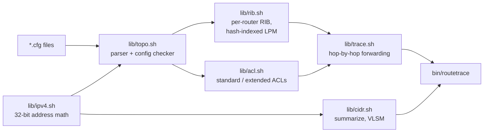

# routetrace-sh

An offline IPv4 forwarding and ACL simulator, written in Bash. You give it a
directory of Cisco IOS-style router configs. It builds each router's routing
table, applies the access lists bound to its interfaces, and traces a packet
hop by hop, telling you where it is delivered or which line dropped it.

It answers questions like "can host 10.3.0.20 reach the server on TCP 3389,
and if not, which ACL entry stops it?" without touching a live network. It
also includes the subnetting tools you need while writing those configs: a
subnet calculator, exact route summarization and VLSM allocation.

Everything runs in plain Bash (3.2 or newer, so the stock macOS shell works
too) plus `sort`, `awk` and `tr`. Python is only used by the tests, as an
independent reference.

## Running it

```sh
git clone <this repo> && cd routetrace-sh
bin/routetrace help
```

Trace a packet through the example 4-router network in `examples/campus`:

```
$ bin/routetrace trace examples/campus 10.3.0.20 10.2.0.10 -p tcp -d 3389
trace tcp 10.3.0.20:40000 -> 10.2.0.10:3389
 1  R3     in GigabitEthernet0/2  [S 0.0.0.0/0 [1/0] via 10.0.23.1]  out GigabitEthernet0/1 -> 10.0.23.1
 2  R2     in GigabitEthernet0/1  [C 10.2.0.0/24 is directly connected, GigabitEthernet0/2]  out GigabitEthernet0/2 -> 10.2.0.10  acl SERVERS out on GigabitEthernet0/2: '60 deny ip any any log'
RESULT DROPPED denied by ACL SERVERS out on R2 GigabitEthernet0/2 (hops: 2)

$ bin/routetrace trace examples/campus 10.3.0.5 198.51.100.1
trace icmp 10.3.0.5:40000 -> 198.51.100.1:0
 1  R3     in GigabitEthernet0/2  [S 0.0.0.0/0 [1/0] via 10.0.23.1]  out GigabitEthernet0/1 -> 10.0.23.1
 2  R2     in GigabitEthernet0/1  [S 0.0.0.0/0 [1/0] via 203.0.113.1, GigabitEthernet0/3]  out GigabitEthernet0/3 -> 203.0.113.1
 3  ISP    in GigabitEthernet0/0  local Loopback0
RESULT DELIVERED to router ISP Loopback0 (hops: 3)
```

The exit status is 0 if the packet was delivered, 1 if it was dropped and 2
for bad input, so traces can be used as assertions in scripts (for example,
"after this ACL change, the web server must still be reachable from LAN A").

Other commands:

```
$ bin/routetrace routes examples/campus R2        # like "show ip route"
S 0.0.0.0/0 [1/0] via 203.0.113.1, GigabitEthernet0/3
C 10.0.12.0/30 is directly connected, GigabitEthernet0/0
C 10.0.23.0/30 is directly connected, GigabitEthernet0/1
S 10.1.0.0/16 [1/0] via 10.0.12.1
C 10.2.0.0/24 is directly connected, GigabitEthernet0/2
S 10.3.0.0/16 [1/0] via 10.0.23.2
S 10.99.0.0/16 [1/0] is directly connected, Null0
C 203.0.113.0/30 is directly connected, GigabitEthernet0/3

$ bin/routetrace check tests/fixtures/broken       # config problems
mask mismatch: X Gi0/0 /24 vs Y Gi0/0 /25
X Gi0/0: inbound ACL MISSING is not defined (permits all)
duplicate address 10.9.9.1 on Y Gi0/1 and X Gi0/1
X: next hop 10.0.0.77 of 'S 172.17.0.0/16 [1/0] via 10.0.0.77' is not a known router interface
X: 'S 172.16.0.0/16 [1/0] via 192.0.2.1' not installed, next hop does not resolve
5 problem(s) found in 2 router(s)

$ bin/routetrace summarize 10.1.0.0/24 10.1.1.0/24 10.1.2.0/23 10.1.4.0/24
10.1.0.0/22
10.1.4.0/24

$ bin/routetrace vlsm 10.10.0.0/22 lab:100 office:300 p2p:2 guest:50
name         wanted  subnet             usable  range
office          300  10.10.0.0/23          510  10.10.0.1-10.10.1.254
lab             100  10.10.2.0/25          126  10.10.2.1-10.10.2.126
guest            50  10.10.2.128/26         62  10.10.2.129-10.10.2.190
p2p               2  10.10.2.192/30          2  10.10.2.193-10.10.2.194
```

Also available: `calc` (subnet calculator), `lookup` (one longest-prefix
match on one router) and `acl` (evaluate one ACL against one packet).

### Supported config subset

```
hostname NAME
interface NAME
 ip address A.B.C.D MASK
 shutdown | no shutdown
 ip access-group ACL in|out
ip route PREFIX MASK (NEXTHOP | IFACE [NEXTHOP] | Null0) [DISTANCE]
access-list 1-99|1300-1999 permit|deny SOURCE                 (standard)
access-list 100-199|2000-2699 permit|deny PROTO SRC [PORT] DST [PORT] [established] [log]
ip access-list standard|extended NAME   + indented entries, optional sequence numbers
```

Address specs are `any`, `host A.B.C.D` or `A.B.C.D WILDCARD` (non-contiguous
wildcards like `0.0.255.0` work). Port operators are `eq`, `neq`, `lt`, `gt`
and `range`, with the usual IOS names (`www`, `ssh`, `domain`, ...). Other
config lines are ignored, so real configs with `description`, `duplex` and
so on load fine.

## Architecture



What happens at each hop in `trace_packet`:

```
packet arrives on interface IN of router R
  -> inbound ACL on IN            (first match wins, implicit deny)
  -> destination is one of R's own addresses?  -> DELIVERED to router
  -> TTL - 1, drop at 0           (catches routing loops)
  -> longest-prefix match in R's RIB              -> no route: DROPPED
  -> resolve next hop recursively to an exit interface (Null0 -> DROPPED)
  -> outbound ACL on the exit interface
  -> who owns the next-hop address on that segment?
        another router -> repeat on that router
        nobody, and the next hop is the destination -> DELIVERED to host
        nobody otherwise -> DROPPED (ARP failure)
```

Design points worth knowing:

- **Longest-prefix match with O(1) probes.** Bash's indexed arrays are linked
  lists, so a binary trie built on them would be slow. Instead every installed
  prefix becomes a shell variable named `_RB_<router>_<len>_<network>` that
  holds the route id. Shell variables live in a hash table, so a lookup is
  one probe per prefix length present in the table (at most 33), not one
  per route. The prefix lengths are kept in a sorted list, longest first.
- **No subshells on hot paths.** Functions return results through `REPLY`
  and other globals instead of `$(...)`, which would fork a process per call.
- **IOS route selection.** For the same prefix, the route with the lower
  administrative distance wins, then the lower metric. A static route via a
  next-hop address is installed only once that address resolves, retried
  until nothing changes, so floating static routes take over when a link is
  shut down. As on IOS, a next hop can also resolve through the default
  route; `check` warns when that is the only way it resolves.
- **Module layout.** `ipv4.sh` (parsing, masks, containment), `cidr.sh`
  (range merging and range-to-CIDR splitting for summarization, largest-first
  VLSM), `rib.sh`, `acl.sh`, `topo.sh` (parser, `show ip route`, checker),
  `trace.sh`. All are Bash 3.2 compatible: no associative arrays, no
  `mapfile`, no namerefs.

## Tests

```sh
bash tests/run.sh
```

64 tests in `tests/test_*.sh`, each run in its own subshell:

- unit tests for address parsing (including leading zeros, which Bash would
  otherwise read as octal), masks, summarization, VLSM, RIB selection,
  recursive next-hop resolution, and every ACL operator;
- end-to-end traces through `examples/campus` covering delivery, inbound and
  outbound ACL drops, `established`, null routes, a link failure with and
  without a default route, a two-router routing loop (TTL exceeded), no route,
  ARP failure, exit codes, the config checker and parse errors with file and
  line number;
- randomized property tests (`tests/test_property.sh`) that compare the Bash
  code with `tests/oracle.py`: CIDR math and summarization against Python's
  `ipaddress` (`collapse_addresses`), longest-prefix match against a brute
  force search, and ACL wildcard matching against a bit-by-bit reference.
  Breaking the ACL matcher, the prefix-length ordering or the range merge
  makes these tests fail.

CI (`.github/workflows/ci.yml`) runs shellcheck, the tests, a few example
commands and `bench/bench.sh --quick` on ubuntu-latest (bash 5) and
macos-latest (bash 3.2).

## Benchmark

```sh
bench/bench.sh            # full run
bench/bench.sh --quick    # smaller sizes, used in CI
```

It times route insertion, hash-indexed LPM against the linear-scan reference
(`rib_lookup_linear`) on random tables of 100, 1,000 and 10,000 routes, and
checks that both give the same answer on the sampled probes. It also times ACL
evaluation, summarization, and packet traces both in-process and through the
CLI (which includes parsing the four config files).

Results from `bench/bench.sh` on this machine (Apple Silicon). First the stock
macOS `/bin/bash`:

```
bash 3.2.57(1)-release, Darwin arm64
```

| routes | prefix lengths | inserts/s | hash LPM lookups/s | linear scan lookups/s | speedup | linear disagreements / probes checked |
|-------:|---:|---:|---:|---:|---:|---|
|    100 | 15 |    5751.4 |   12544.7 |   914.5 | 13.7x | 0/2000 |
|   1000 | 15 |   11640.2 |   12408.2 |    51.5 | 240.9x | 0/200 |
|  10000 | 15 |    8773.6 |    6407.5 |     0.6 | 10679.1x | 0/20 |

| ACL entries | packets | evals/s | permitted |
|---:|---:|---:|---:|
|   10 |   1000 |   8810.1 |   50% |
|  100 |   1000 |   1434.3 |   50% |

| summarize: input prefixes | output prefixes | ms |
|---:|---:|---:|
|   500 |   311 |     106 |
|  2000 |   320 |     641 |

| trace | runs | rate |
|---|---:|---:|
| in-process trace_packet, 4-router campus | 200 | 1283.1 traces/s (120 delivered) |
| CLI process (config parse + trace) | 20 | 103 ms/run |

The same command in a Linux container (`python:3.12-slim` under Docker on the
same machine):

```
bash 5.2.37(1)-release, Linux aarch64
```

| routes | prefix lengths | inserts/s | hash LPM lookups/s | linear scan lookups/s | speedup | linear disagreements / probes checked |
|-------:|---:|---:|---:|---:|---:|---|
|    100 | 15 |   20738.2 |   22249.1 |  1661.6 | 13.3x | 0/2000 |
|   1000 | 15 |   19222.6 |   22053.3 |   163.7 | 134.7x | 0/200 |
|  10000 | 15 |   20493.2 |   22895.6 |    16.4 | 1396.0x | 0/20 |

| ACL entries | packets | evals/s | permitted |
|---:|---:|---:|---:|
|   10 |   1000 |  17147.0 |   50% |
|  100 |   1000 |   2593.9 |   50% |

| summarize: input prefixes | output prefixes | ms |
|---:|---:|---:|
|   500 |   314 |      45 |
|  2000 |   321 |     167 |

| trace | runs | rate |
|---|---:|---:|
| in-process trace_packet, 4-router campus | 200 | 2171.8 traces/s (120 delivered) |
| CLI process (config parse + trace) | 20 | 37 ms/run |

How to read these:

- On bash 5.2 the hash lookup rate stays flat from 100 to 10,000 routes, as
  expected for a cost that depends on the number of prefix lengths (15 here)
  rather than the number of routes. On bash 3.2 it halves at 10,000 routes;
  my guess is that 3.2's variable hash table does not grow, so its buckets
  get longer, but I have not confirmed this.
- The linear scan gets worse faster than O(n) on bash 3.2 because reading
  element `i` of an indexed array walks the list. Bash 5 remembers the last
  position, which is why it scales better there.
- `$RANDOM` gives different sequences in bash 3.2 and 5.2, so the random
  inputs differ slightly between the two runs (311 vs 314 summarized prefixes).
- These are throughput numbers for a shell script, which is slow next to
  compiled code. The point is that the algorithm choice matters inside Bash
  too, not that Bash is fast.

## Limitations

- IPv4 only. Static and connected routes only: no OSPF, EIGRP or BGP, so
  dynamic routing has to be written as equivalent static routes.
- No equal-cost multipath; for the same prefix, distance and metric, the first
  route in the config wins.
- No NAT, no VRFs, no policy-based routing, no reflexive ACLs or zone-based
  firewall, no `object-group`s. `established` only checks a flag you pass
  with `-e`; there is no connection tracking.
- Named ACL entries are evaluated in file order. Sequence numbers are
  accepted but not used to re-order.
- Layer 2 is reduced to "who owns this IP on this subnet": no VLANs, ARP
  timing, MTU or spanning tree. Any address on a connected subnet that is not
  a router interface is assumed to be a live host.
- Interfaces are matched by the exact name used in the config
  (case-insensitive). `Gi0/0` and `GigabitEthernet0/0` are different names.
- Commands it does not recognise are skipped (and counted in
  `TOPO_IGNORED`), so a misspelled command such as `ip rout ...` is ignored
  rather than reported. Malformed versions of supported commands are errors.

## License

MIT
